<H1>SolarSystemKMP</H1>

Explore the wonders of our solar system! Discover detailed information about each planet, from Mercury to Neptune

  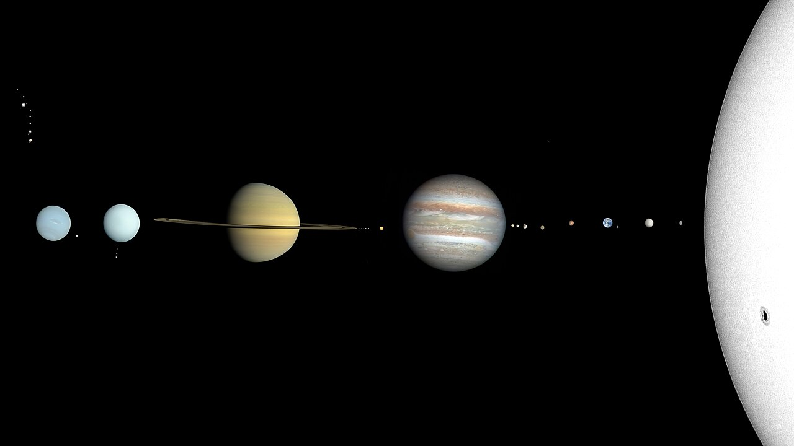

## Stack
- 🍎 Shared UI - [Compose Multiplatform](https://github.com/JetBrains/compose-multiplatform)
- 🚏 Navigation - [Androidx](https://www.jetbrains.com/help/kotlin-multiplatform-dev/compose-navigation-routing.html#sample-project)
- 🏗 ViewModel - [Androidx](https://touchlab.co/kmp-viewmodel)
- 💉 Dependecy Injection - [Koin](https://github.com/InsertKoinIO/koin)
- 🛢 Image Loading - [Coil](https://github.com/coil-kt/coil)

---

<pre>
<h2 align="center">Домашнее задание №1</h2>
</pre>

### ✅ Выполненные задачи:
1. **Рефакторинг загрузки данных:** Добавлена универсальная `Result`-обёртка (`Success` / `Error`) в репозиторий. Реализовано корректное отображение состояния ошибки в UI с кнопкой повторной попытки.
2. **Локализация:** Созданы строковые ресурсы для русского (`values-ru`) и английского (`values`) языков с поддержкой динамического переключения интерфейса.
3. **Экран «О приложении»:** Создан отдельный экран с информацией о версии приложения (1.0.0) и разработчике, настроена навигация с главного экрана и обратно.
4. **CI/CD и качество кода:** Настроен GitHub Actions Workflow для автоматической сборки и запуска Unit-тестов, интегрирован статический анализатор кода **Detekt**.

  
  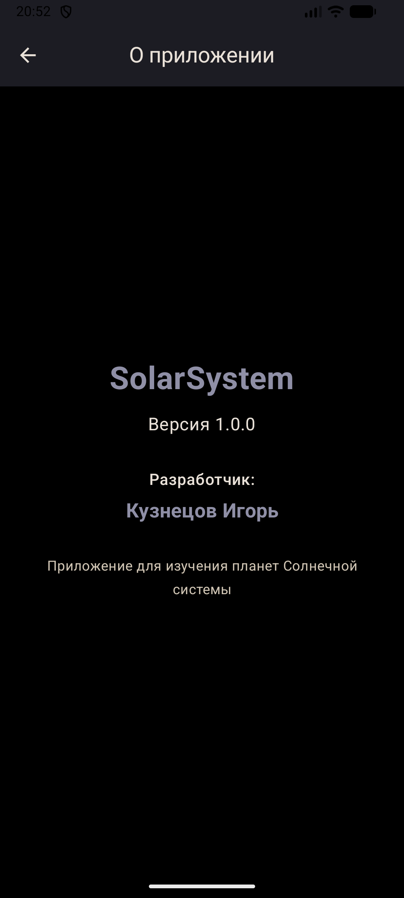

  <em>Обработка ошибки и навигация</em>

  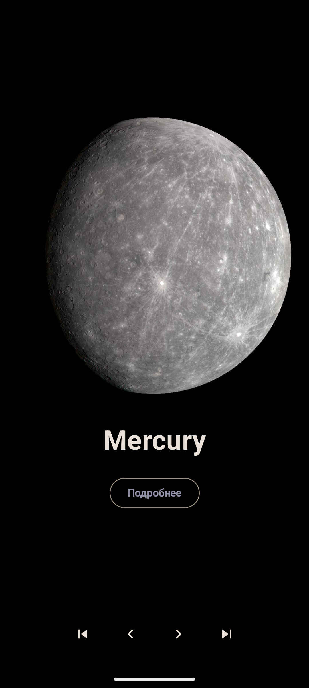

  <em>Поддержка русского и английского языков</em>

---

<pre>
<h2 align="center">Android</h2>
</pre>

  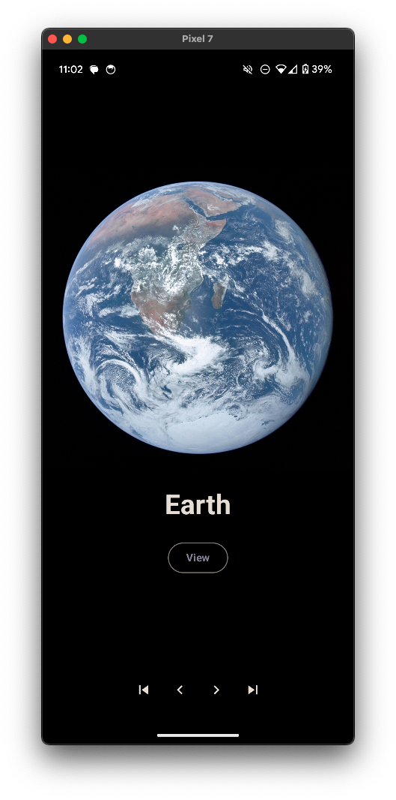
  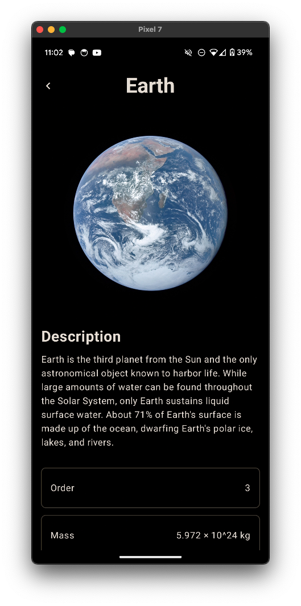

<pre>  
<h2 align="center">IOS</h2>
</pre>

  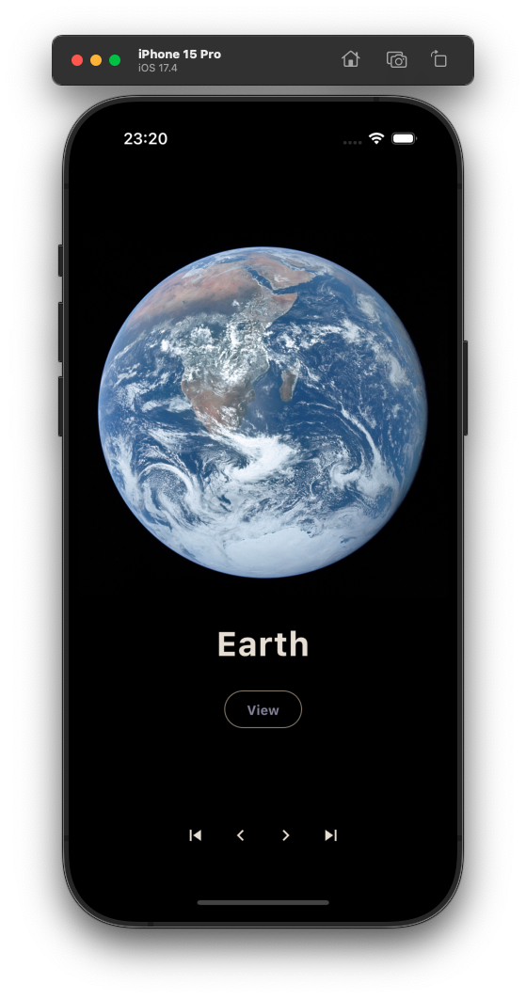
  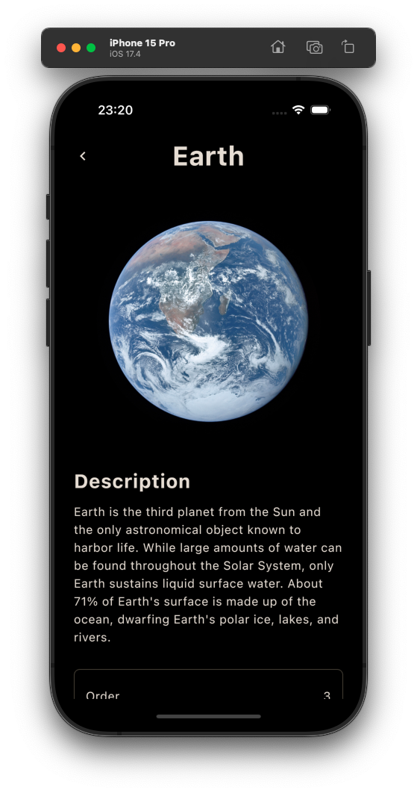

<pre> 
<h2 align="center">Desktop</h2>
</pre>

  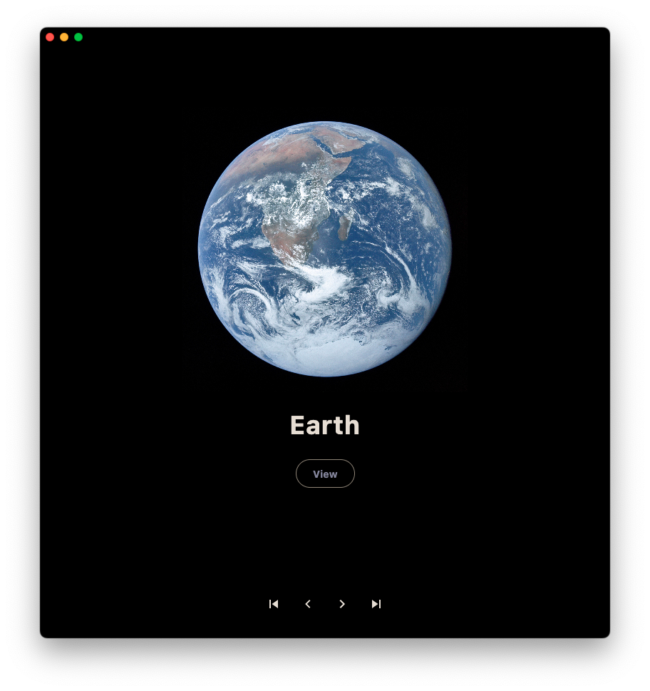
  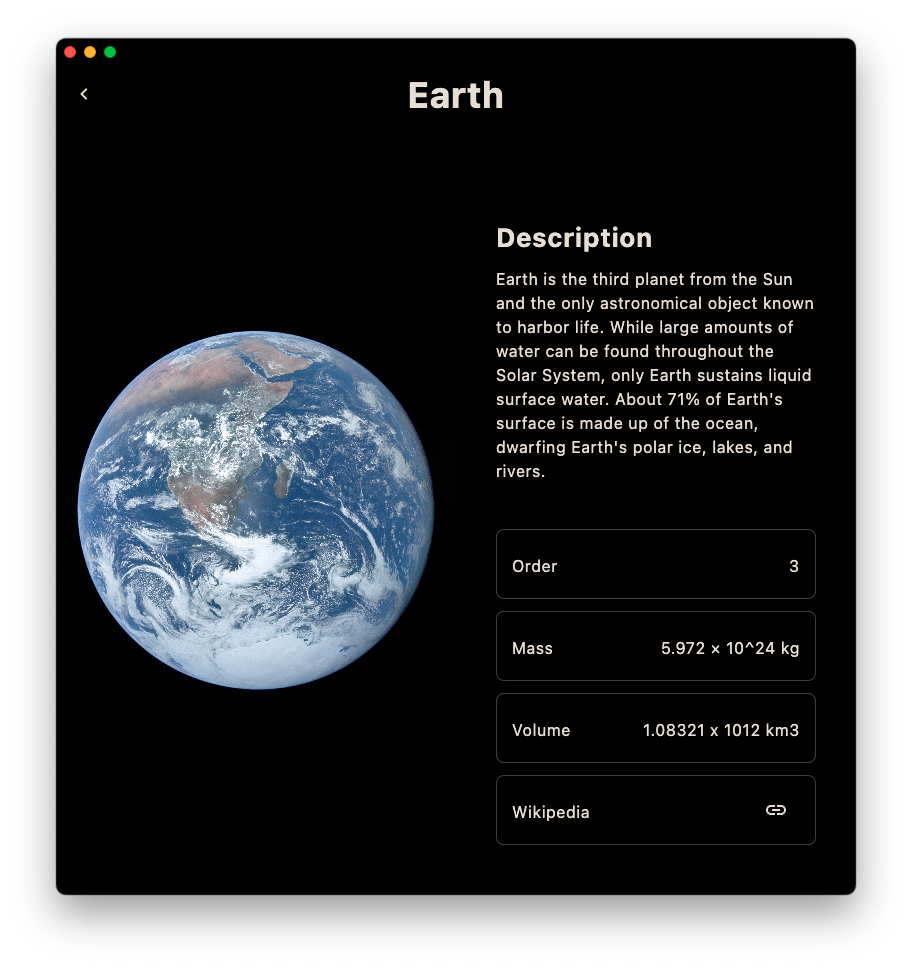

<pre> 
<h2 align="center">Web</h2>
</pre>

  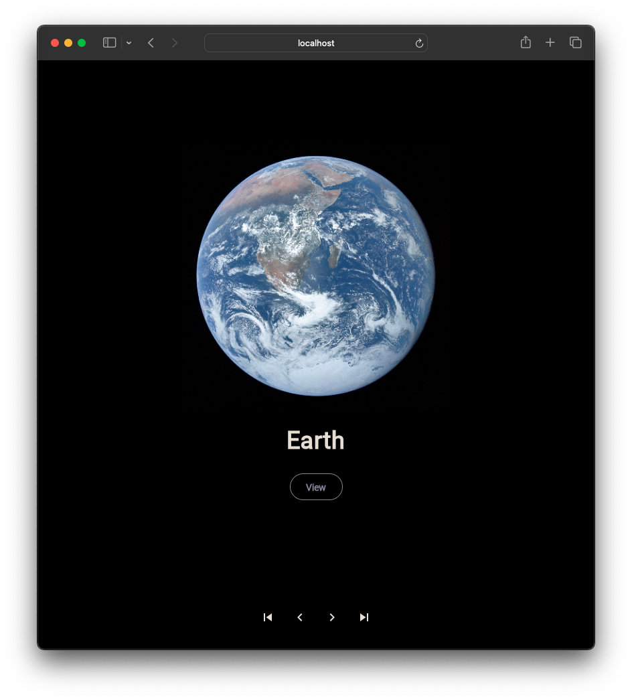
  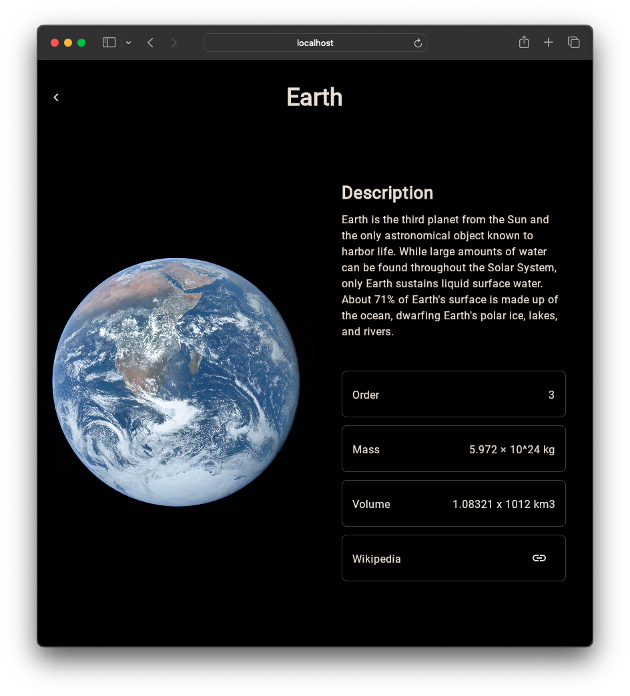

<pre>
<h2 align="center">Web Mobile</h2>
</pre>

  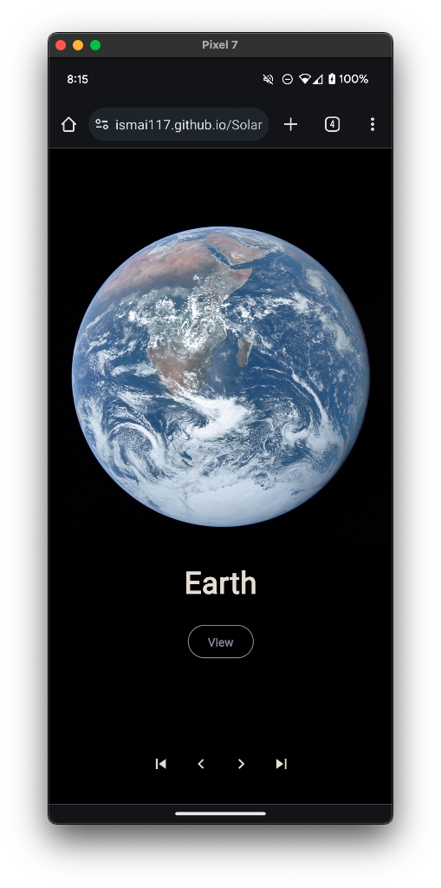
  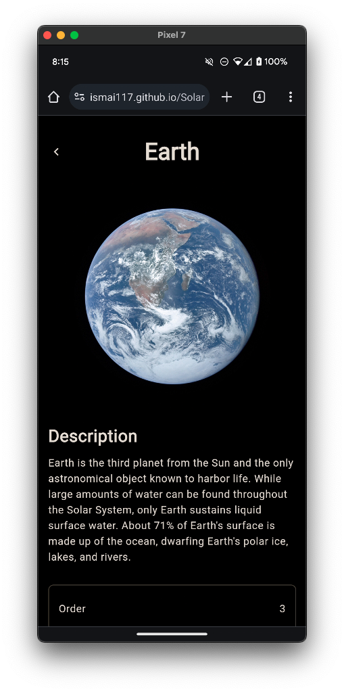

